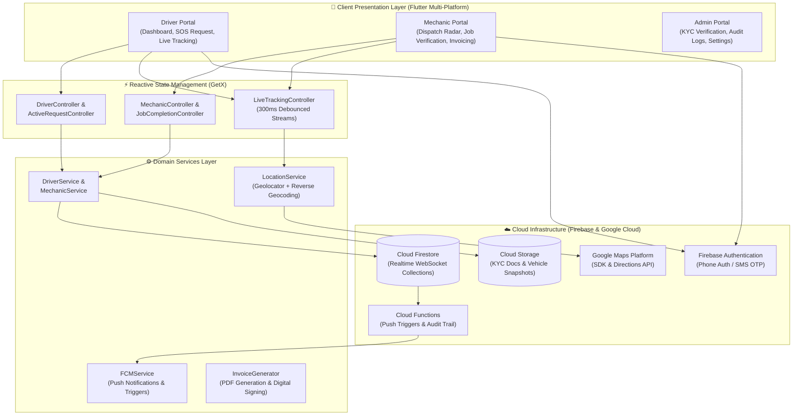
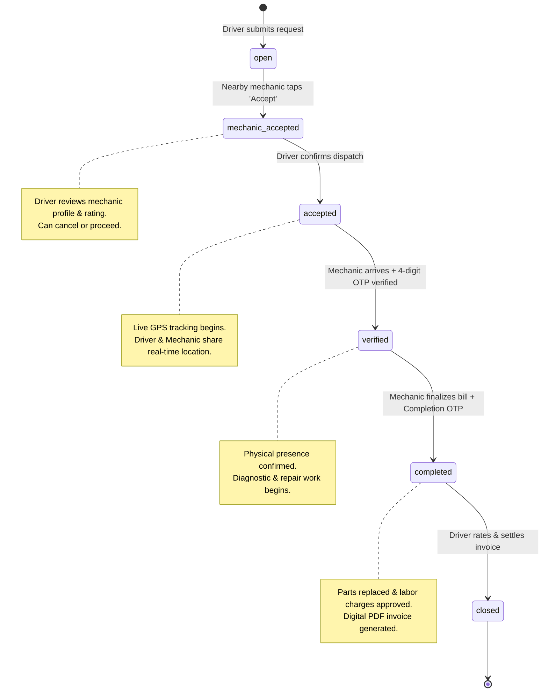

# DriveResQ — System Architecture & Engineering Blueprint

DriveResQ is engineered as a reactive, event-driven mobile platform built on Flutter and Google Firebase. It delivers sub-second bidirectional synchronization between stranded drivers, field mechanics, and administrative supervisors.

---

## 🏛️ High-Level System Architecture



---

## 🔄 End-to-End Request State Lifecycle

Every roadside assistance event follows a deterministic, fraud-resistant finite state machine:



---

## 📂 Production Folder Structure

The codebase is organized into cleanly decoupled domain modules:

```
lib/
├── app/
│   └── routes/                 # Named routes & page bindings (AppPages, Routes)
├── admin/                      # Back-office KYC approval & administrative views
│   ├── controllers/            # Verification, settings, and auth controllers
│   ├── views/                  # Review applications, approved/rejected lists
│   └── widgets/                # Admin tab components & metric cards
├── data/
│   └── models/                 # RequestModel, UserModel, VehicleProfile schemas
├── modules/
│   ├── auth/                   # Phone OTP login, role selector, animated splash
│   ├── driver/                 # Driver user journey
│   │   ├── controllers/        # DriverController, CreateRequest, FindMechanics
│   │   ├── services/           # DriverService, LocationService
│   │   └── views/              # Dashboard, request creation, mechanics map
│   ├── mechanic/               # Mechanic user journey
│   │   ├── controllers/        # MechanicController, Onboarding, History
│   │   ├── services/           # MechanicService
│   │   └── views/              # Job radar, active job card, KYC onboarding steps
│   ├── tracking/               # Live GPS breadcrumb tracking on native GoogleMap
│   ├── jobs/                   # Itemized quote generator & PDF invoice engine
│   ├── chat/                   # In-app real-time messaging between driver & mechanic
│   ├── notifications/          # FCM background notification receivers
│   └── settings/               # User preferences & security
├── shared/
│   ├── services/               # Rating, error handler, connectivity monitor
│   └── widgets/                # Universal UI components (Drawers, Snackbars, Shimmers)
├── theme/                      # AppColors, AppTheme, typography tokens
├── utils/                      # Responsive sizing, distance math, validators
└── main.dart                   # Application bootstrap & dependency injection
```

---

## ⚡ Performance & Low-Latency Architecture

### 1. Zero-Jank Native Platform View Isolation
- Traditional Flutter apps suffer severe FPS stutter when embedding `GoogleMap` inside reactive observers because each GPS coordinate rebuilds the underlying Android `SurfaceView` / iOS `UIView`.
- **DriveResQ Architecture**: Native maps are initialized exactly once. Location streams animate the native camera via `GoogleMapController.animateCamera()` and only stream updates to an isolated `RxSet<Marker>`.
- The user interface maintains a locked 60 FPS even during 1-second continuous GPS streaming.

### 2. Debounced Geo-Filtering
- Keystrokes in mechanic search or range slider tweaks do not re-query Firestore.
- Firestore queries maintain active single-field indexed streams (`driverId` or `status == open`), and distance filtering occurs in-memory via the Haversine formula (`distance_helper.dart`) debounced at 300ms.

### 3. Fault-Tolerant Network & Snackbar Pipeline
- Network interruptions or delayed GPS satellites fall back gracefully to reverse geocoding of user-typed landmarks.
- Snackbars and toast overlays are throttled with a 2-second sliding window deduplicator (`AppSnackbar`), preventing UI freezes from repeated network retries.

---

## 🛡️ Security, Privacy & Compliance

| Layer | Implementation | Security Objective |
|---|---|---|
| **Identity** | Firebase Phone Auth (SMS OTP) | Ensures authenticated identity tied to verified carrier SIM. |
| **Data Protection** | Firestore Security Rules | Drivers can only read/write their requests; mechanics can only access jobs assigned to them. |
| **Document Privacy** | Cloud Storage Tokenized URLs | Mechanic identity papers, driving licenses, and trade certificates reside in protected admin buckets. |
| **Physical Safety** | Dual OTP Handshake | Zero ambiguity on roadside meeting; guarantees physical presence before service initiation. |
