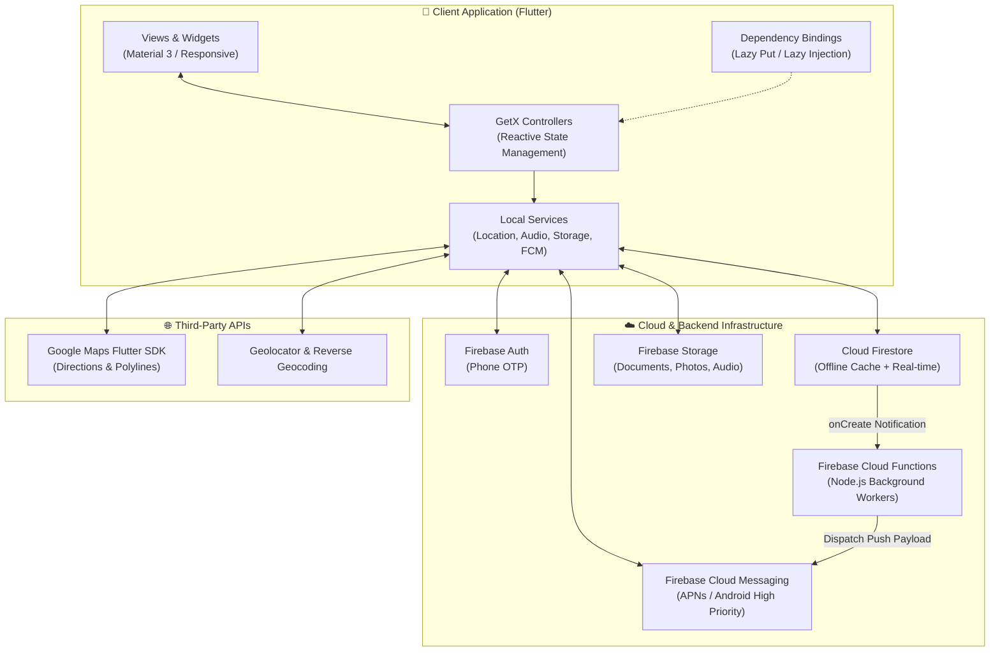

<div align="center">

# 🚗 DriveResQ — On-Demand Roadside Assistance & Mechanic Dispatch Platform

<p align="center">
  <strong>Instant Roadside Rescue • Real-Time GPS Tracking • In-App Negotiation & Voice Chat • Multi-Role Verification</strong>
</p>

[](https://flutter.dev)
[](https://dart.dev)
[](https://firebase.google.com)
[](https://pub.dev/packages/get)
[](#platforms-supported)
[](LICENSE)

<br/>


</div>

---

## 📖 Table of Contents

- [Overview](#-overview)
- [Key Features](#-key-features)
  - [Driver Experience](#1-driver-experience)
  - [Mechanic Experience](#2-mechanic-experience)
  - [Real-Time Communication & Quoting](#3-real-time-communication--in-app-quoting)
  - [Admin Management Portal](#4-admin-management-portal)
- [App UI & Screens Showcase](#-app-ui--screens-showcase)
- [Technical Architecture](#-technical-architecture)
- [Project Directory Structure](#-project-directory-structure)
- [Database Schema & Collections](#-database-schema--collections)
- [Getting Started & Installation](#-getting-started--installation)
  - [Prerequisites](#prerequisites)
  - [Step-by-Step Setup](#step-by-step-setup)
- [Configuration & Environment Secrets](#-configuration--environment-secrets)
  - [Firebase Configuration](#1-firebase-configuration)
  - [Google Maps API Setup](#2-google-maps-api-setup)
  - [Environment Variables (.env)](#3-environment-variables-env)
- [Cloud Functions & Push Notifications](#-cloud-functions--push-notifications)
- [Security & Access Rules](#-security--access-rules)
- [Developer Mode & Testing](#-developer-mode--testing)
- [Troubleshooting & FAQs](#-troubleshooting--faqs)
- [Roadmap](#-roadmap)
- [Contributing](#-contributing)
- [License](#-license)

---

## 🌟 Overview

**DriveResQ** is a full-stack, enterprise-ready roadside assistance ecosystem engineered with Flutter and Firebase. It eliminates the friction, vulnerability, and uncertainty motorists face during highway and city breakdowns by instantly connecting stranded drivers with vetted nearby automotive mechanics.

### The Problem It Solves
When motorists face a flat tire, dead battery, engine breakdown, or fuel outage, traditional roadside assistance often involves long hotline wait times, opaque pricing, and zero visibility into technician arrival times. Local mechanics also lack a unified digital platform to receive on-demand dispatch calls.

### The DriveResQ Solution
DriveResQ bridges this gap through a unified mobile and web architecture:
- **Instant Geo-Dispatch**: Drivers broadcast rescue requests with pinpoint GPS coordinates, vehicle details, and photo evidence.
- **Fair In-App Quoting**: Mechanics can review the problem, send official itemized estimates in real-time chat, and prevent surprise charges.
- **Turn-by-Turn Live Tracking**: Live Google Maps integration displays mechanic transit routes, live coordinates, and estimated arrival times (ETA).
- **Fraud-Proof Job Verification**: 6-digit security OTP verification ensures jobs are only marked complete when the driver physically inspects the service.
- **Admin Verification Gate**: All mechanics undergo a thorough 6-step verification flow where government IDs and workshop licenses are reviewed and approved before going live.

---

## ⚡ Key Features

### 1. Driver Experience
- **One-Tap Emergency Dispatch**: Automatically captures driver GPS coordinates, reverse-geocodes the exact street address, and allows manual landmark specifications.
- **Multi-Vehicle Support**: Tailored service categories for **Bikes, Scooters, Sedans, SUVs, Vans, Trucks, Auto-Rickshaws, and Buses**.
- **Issue Diagnostics & Photos**: Drivers describe the problem and attach camera photos of vehicle damage or flat tires for fast diagnosis.
- **Nearby Mechanics Radar**: Interactive Google Map with custom markers showing available certified mechanics within radius, toggleable between Map and List views.
- **Live Mechanic Tracking**: High-frequency map updates showing the mechanic approaching in real-time with route polylines and real-time distance calculations.
- **Safety Tips & SOS Guidance**: Built-in safety instructions displayed while waiting for the technician to ensure roadside security.
- **Digital Job Receipts & PDF Invoicing**: Downloadable, printable digital receipts itemizing labor, spare parts, and service fees with one-tap sharing.
- **5-Star Rating & Reviews**: Comprehensive driver feedback mechanism factoring into public mechanic reputation scores.

### 2. Mechanic Experience
- **6-Step Professional Onboarding**:
  1. *Personal Details*: Full legal name, contact, emergency phone.
  2. *Professional Profile*: Workshop name, years of experience, offered services, vehicle specialties.
  3. *Document Verification*: Aadhaar / National ID, mechanic trade certification, workshop ownership license.
  4. *Bank & Payouts*: Account details and UPI handles for settlement.
  5. *Availability & Operating Hours*: 24/7 emergency availability toggle.
  6. *Legal Agreement*: Terms of service and roadside liability waivers.
- **Active Dispatch Dashboard**: Real-time incoming rescue requests with distance, vehicle type, reported problem, and driver contact.
- **Availability Toggle**: Instant Online / Offline switch controlling visibility in driver radars.
- **Live Navigation**: Built-in map navigation directing technicians straight to the stranded vehicle.
- **6-Digit Secure Completion**: Mechanics request a 6-digit code provided to the driver to finalize job execution and unlock payouts.
- **Earnings & Service History**: Historic log of completed rescues, accumulated earnings, and driver feedback.

### 3. Real-Time Communication & In-App Quoting
- **Instant Chat Engine**: Zero-latency Firestore message streaming with unread badge counters.
- **Voice Messages (Walkie-Talkie)**: Audio recording and playback with dynamic waveforms for hands-free driver-technician coordination.
- **Official Price Quote Cards**: Mechanics submit formal structured quotes directly within the chat thread; drivers can Accept or Decline with a single tap.
- **Photo Attachments**: High-resolution image uploads stored in Firebase Storage.
- **Direct Phone Dialer**: Fallback one-touch phone dialer triggering the native dialer without exposing sensitive personal info.

### 4. Admin Management Portal
- **Web-Ready Dashboard**: Dedicated web interface (`/admin`) for platform moderators and dispatch managers.
- **Applicant Queue**: Tabbed workflow reviewing **Pending**, **Approved**, and **Rejected** mechanic and driver submissions.
- **Document Inspection Viewer**: Fullscreen document preview for verifying government IDs and certification validity.
- **Audit Trails & Reasons**: Rejection notes sent directly to mechanics with re-submission capabilities.
- **Platform Analytics**: Real-time counters for active jobs, onboarded drivers, verified mechanics, and daily completions.

---

## 📱 App UI & Screens Showcase

> *Drop your actual screenshots into the `assets/screenshots/` directory matching the paths below to display live UI previews.*

### 🚗 Driver Journey

| Splash & Role Selection | Driver Dashboard | Emergency Request |
|:---:|:---:|:---:|
|  |  |  |
| **Driver & Mechanic Selection** | **Quick Actions & Active Status** | **Vehicle & Issue Details** |

| Find Mechanics (Map / List) | Live GPS Tracking | Job Receipt & Rating |
|:---:|:---:|:---:|
|  |  |  |
| **Mechanics Radar & Filters** | **En-Route Polyline Navigation** | **Itemized Bill & 5★ Review** |

---

### 🔧 Mechanic Journey & Dispatch

| Mechanic Onboarding (6 Steps) | Pending Verification | Mechanic Dashboard |
|:---:|:---:|:---:|
|  |  |  |
| **Certificates & Verification** | **Admin Review Gate** | **Incoming Request Alerts** |

---

### 💬 Real-Time Chat, Negotiation & 🛡️ Admin Portal

| In-App Chat & Price Quotes | Voice Notes & Media | Admin Web Portal |
|:---:|:---:|:---:|
|  |  |  |
| **Transparent Quoting** | **Waveform Audio Player** | **Desktop Verification Console** |

---

## 🏗️ Technical Architecture

DriveResQ is engineered around clean separation of concerns using **GetX MVC + Services architecture**:



### Technology Matrix

| Layer | Technology | Purpose |
|---|---|---|
| **Language & Framework** | Dart 3.x, Flutter 3.10+ | Cross-platform client for iOS, Android, and Web |
| **State & Navigation** | GetX (`^4.7.3`) | High-performance reactive state, reactive streams, routing |
| **Backend & Database** | Firebase Cloud Firestore | NoSQL document database with persistent offline caching |
| **Authentication** | Firebase Auth | Phone number authentication via SMS OTP |
| **Push Notifications** | Firebase Cloud Messaging (FCM) + Local Notifications | High-priority background/foreground dispatch |
| **Background Compute** | Cloud Functions (Node.js 18+) | Automated notification pipeline (`processNotification`) |
| **Cloud Storage** | Firebase Storage | Storage for IDs, mechanic licenses, images, voice notes |
| **Maps & Location** | Google Maps Flutter, Geolocator, Geocoding | Real-time coordinate tracking, custom markers, polylines |
| **Media & Audio** | `record`, `audioplayers`, `image_picker` | Voice note audio encoding/decoding, photo capture |
| **Documents & Export** | `pdf`, `printing`, `share_plus` | Digital receipts, PDF generation, native sharing |
| **UI Aesthetics** | Google Fonts, Iconsax, Flashy Flushbar, Shimmer | High-fidelity dark/light styling and micro-interactions |

---

## 📁 Project Directory Structure

```text
DriveResQ-App/
├── .env.example                     # Environment secrets template
├── android/                         # Android native configurations & manifests
├── ios/                             # iOS Xcode workspace and plist configs
├── web/                             # Web support assets for Admin Portal
├── assets/
│   ├── icon/                        # App launcher icons
│   ├── logo.png                     # Official DriveResQ brand logo
│   └── screenshots/                 # Application screenshots & hero banners
│       ├── hero_banner.jpg
│       └── ...
├── functions/                       # Firebase Cloud Functions (Node.js)
│   ├── package.json
│   └── index.js                     # FCM automated notification dispatch trigger
├── firestore.rules                  # Firestore document security rules
├── storage.rules                    # Firebase Storage security rules
├── pubspec.yaml                     # Project manifest and package dependencies
└── lib/
    ├── main.dart                    # Application bootstrap & background FCM handler
    ├── firebase_options.dart        # Platform-specific Firebase credentials
    ├── admin/                       # Admin Web & Tablet Portal
    │   ├── controllers/             # Admin dashboard, auth & verification controllers
    │   ├── views/                   # Dashboard, document review, pending lists
    │   └── widgets/                 # Sidebar navigation, stat cards, applicant modals
    ├── app/
    │   └── routes/                  # Named routes (AppPages & AppRoutes)
    ├── data/
    │   └── models/                  # UserModel, RequestModel, Chat models
    ├── modules/
    │   ├── auth/                    # Splash, Onboarding, Role Selection, Phone OTP
    │   ├── driver/                  # Driver Dashboard, Find Mechanics, Emergency Dispatch
    │   ├── mechanic/                # 6-Step Onboarding, Request Queue, Navigation
    │   ├── chat/                    # Real-time messages, audio recorder, quote cards
    │   ├── jobs/                    # 6-digit OTP completion, digital invoice, rating
    │   ├── notifications/           # FCM service, local notification channels
    │   ├── settings/                # Profile editing, theme toggles, app settings
    │   └── tracking/                # Google Maps live tracking controller & views
    ├── shared/                      # Global widgets, error handlers, rating dialogs
    ├── theme/                       # AppColors, typography, themes (Light & Dark)
    └── utils/                       # Helpers, dialogs, formatters, DevRole switcher
```

---

## 🗄️ Database Schema & Collections

DriveResQ relies on a structured, relational-like Firestore database designed for high read speeds and real-time subscription streams:

### 1. `users` Collection
Stores driver, mechanic, and admin profiles.
```json
{
  "uid": "USER_FIREBASE_UID",
  "phone": "+919876543210",
  "role": "driver | mechanic | admin",
  "fullName": "Dhruv Goel",
  "profilePhotoUrl": "https://storage.googleapis.com/...",
  "isActive": true,
  "fcmToken": "eX_ample_FCM_t0k3n...",
  "driverOnboardingCompleted": true,
  "onboardingCompleted": true,
  "verificationStatus": "pending | approved | rejected",
  "shopName": "Goel Auto Repairs",
  "servicesOffered": ["Flat Tire", "Battery Jump", "Engine Diagnostic"],
  "specializations": ["Hatchback", "SUV", "Electric Vehicles"],
  "latitude": 28.6139,
  "longitude": 77.2090,
  "rating": 4.9,
  "jobsCompleted": 42,
  "isOnline": true,
  "createdAt": "Timestamp",
  "updatedAt": "Timestamp"
}
```

### 2. `requests` Collection
Captures roadside assistance dispatch lifecycle.
```json
{
  "id": "REQUEST_DOC_ID",
  "driverId": "DRIVER_UID",
  "driverName": "Dhruv Goel",
  "driverPhone": "+919876543210",
  "driverLat": 28.6139,
  "driverLng": 77.2090,
  "locationName": "Connaught Place, New Delhi",
  "landmark": "Near Block B Metro Exit",
  "vehicleType": "Car",
  "problem": "Flat Tire",
  "description": "Right front tire punctured, need spare installed.",
  "imageUrl": "https://storage.googleapis.com/...",
  "status": "open | accepted | in_progress | verified | completed | closed",
  "mechanicId": "MECHANIC_UID",
  "mechanicPhone": "+919811223344",
  "verificationCode": "482910",
  "createdAt": "Timestamp"
}
```

### 3. `completedJobs` Collection
Records finalized rescues for accounting and PDF receipts.
```json
{
  "jobId": "REQUEST_DOC_ID",
  "driverId": "DRIVER_UID",
  "mechanicId": "MECHANIC_UID",
  "amount": 450.00,
  "breakdown": {
    "serviceCharge": 250.00,
    "partsCost": 150.00,
    "platformFee": 50.00
  },
  "rating": 5.0,
  "review": "Fast response, reached in 8 minutes and fixed immediately!",
  "completedAt": "Timestamp"
}
```

### 4. `chats` Collection
Contains conversation rooms keyed by `requestId`.
- Subcollection `chats/{requestId}/messages/{messageId}`:
  - `senderId`: String (UID)
  - `receiverId`: String (UID)
  - `text`: String
  - `type`: `"text" | "image" | "audio" | "price_quote"`
  - `audioUrl`: String (URL to `.m4a` file)
  - `quoteAmount`: Double (e.g., `450.0`)
  - `quoteStatus`: `"pending" | "accepted" | "declined"`
  - `timestamp`: Timestamp

### 5. `notifications` Collection
Auto-processed by Cloud Functions to trigger push notifications.
- `recipientId`: Target user UID
- `title`: e.g., "Mechanic Dispatched"
- `body`: e.g., "Rajesh Kumar accepted your request and is en route."
- `processed`: Boolean (set to `true` by Cloud Function)
- `data`: Payload map (route, requestId)

---

## 🚀 Getting Started & Installation

### Prerequisites
Make sure your development machine has:
- **Flutter SDK**: `^3.10.1` or higher ([Install Guide](https://docs.flutter.dev/get-started/install))
- **Dart SDK**: `^3.0.0`
- **Node.js**: `18.x` or `20.x` (for Cloud Functions)
- **Firebase CLI**: `npm install -g firebase-tools`
- **Android Studio** (with Android SDK & Build Tools) or **Xcode** (for macOS/iOS)
- **Google Maps API Key** with Android, iOS, and Geocoding APIs enabled

---

### Step-by-Step Setup

#### 1. Clone the Repository
```bash
git clone https://github.com/dhruvgoel3/DriveResQ-App.git
cd DriveResQ-App
```

#### 2. Install Flutter Dependencies
```bash
flutter pub get
```

#### 3. Setup Secrets & Environment Variables
Copy `.env.example` to `.env`:
```bash
cp .env.example .env
```
Fill in the credentials as outlined in the [Configuration](#-configuration--environment-secrets) section below.

#### 4. Configure Android Maps Key
Open or create `android/app/local.properties` and append:
```properties
MAPS_API_KEY=your_actual_google_maps_api_key_here
```

#### 5. Verify & Run
```bash
# Verify Flutter setup
flutter doctor

# Run on connected device or emulator
flutter run
```

---

## 🔐 Configuration & Environment Secrets

For security reasons, API keys, Firebase service files, and credentials are **not** committed to version control.

### 1. Firebase Configuration
1. Create a project at [Firebase Console](https://console.firebase.google.com/) named `driveresq-app`.
2. Enable **Authentication** (select **Phone Auth**).
3. Enable **Cloud Firestore** and **Firebase Storage**.
4. Download platform config files:
   - **Android**: Place `google-services.json` into `android/app/`
   - **iOS**: Place `GoogleService-Info.plist` into `ios/Runner/`
5. Enable **Firebase Cloud Messaging (FCM)** in Project Settings → Cloud Messaging.

### 2. Google Maps API Setup
1. Go to [Google Cloud Console](https://console.cloud.google.com/).
2. Enable the following APIs:
   - **Maps SDK for Android**
   - **Maps SDK for iOS**
   - **Geocoding API**
   - **Directions API**
3. Generate an API Key and restrict it as needed.
4. Add to `android/app/local.properties`:
   ```properties
   MAPS_API_KEY=AIzaSy...
   ```
5. For iOS, ensure the key is initialized in `ios/Runner/AppDelegate.swift`:
   ```swift
   GMSServices.provideAPIKey("YOUR_IOS_MAPS_KEY")
   ```

### 3. Environment Variables (`.env`)
Populate your root `.env` file:
```env
FIREBASE_WEB_API_KEY=AIzaSy...
FIREBASE_ANDROID_API_KEY=AIzaSy...
FIREBASE_IOS_API_KEY=AIzaSy...
FIREBASE_WINDOWS_API_KEY=AIzaSy...
```

---

## ⚡ Cloud Functions & Push Notifications

DriveResQ includes an automated serverless push notification worker in `functions/index.js`.

### Deploying the Cloud Function
```bash
# 1. Login to Firebase CLI
firebase login

# 2. Select your project
firebase use --add

# 3. Install function dependencies
cd functions
npm install
cd ..

# 4. Deploy functions to Firebase
firebase deploy --only functions
```

### High-Priority Notification Channel
Android notification channel `driveresq_high_priority` is configured for heads-up banners, max volume rings, and custom vibration patterns so emergency dispatch notifications are never missed.

---

## 🔒 Security & Access Rules

Security rules prevent unauthorized reads/writes and enforce identity verification:

1. **Firestore Rules**:
   - Apply the rules from [`FIREBASE_RULES.md`](./FIREBASE_RULES.md) or [`firestore.rules`](./firestore.rules) via Firebase Console.
   - Ensures drivers can only edit their own help requests.
   - Restricts chat creation to participants of that active rescue.
   - Prevents unverified mechanics from accepting jobs.
2. **Storage Rules**:
   - Located in [`storage.rules`](./storage.rules).
   - Only authenticated mechanics can upload identity verification certificates.

---

## 🛠️ Developer Mode & Testing

DriveResQ contains a built-in role switcher for rapid local pair-testing:

```dart
// lib/utils/role_change/dev_config.dart
class DevConfig {
  // ⚠️ Set to false before releasing production builds
  static const bool devMode = true;
}
```

When `devMode` is `true`:
- A role icon appears in the Driver and Mechanic app bars.
- Tapping allows you to instantly switch the active session between **Driver** and **Mechanic** on the same device without re-authenticating.

---

## ❓ Troubleshooting & FAQs

<details>
<summary><strong>Q: Google Maps shows a blank grid on Android.</strong></summary>

- Verify `MAPS_API_KEY` is present in `android/app/local.properties`.
- Ensure **Maps SDK for Android** is enabled in Google Cloud Console.
- Confirm SHA-1 fingerprint of your debug keystore is added to Google Cloud Console credentials.
</details>

<details>
<summary><strong>Q: Firestore throws "Permission Denied" in Chat or Job Completion.</strong></summary>

- Deploy the comprehensive rules in [`FIREBASE_RULES.md`](./FIREBASE_RULES.md).
- Ensure your mechanic user has `verificationStatus: 'approved'`.
</details>

<details>
<summary><strong>Q: Push notifications are not received when app is killed.</strong></summary>

- Confirm Cloud Functions are deployed (`firebase functions:list`).
- Verify device has registered an `fcmToken` in its `users` Firestore document.
- On Android, ensure Battery Optimization is not aggressively sleeping the app.
</details>

---

## 🗺️ Roadmap

- [ ] **Payment Gateway Integration**: Direct UPI / Stripe / Razorpay in-app digital escrow payments.
- [ ] **SOS Emergency Mode**: Automated SMS broadcast with GPS coordinates to emergency family contacts and highway patrol.
- [ ] **AI Damage Assessment**: Camera-based AI scan to predict vehicle diagnostic codes and spare part costs.
- [ ] **Fleet & Corporate Accounts**: B2B dashboard for logistics companies and rental vehicle fleets.

---

## 🤝 Contributing

Contributions are warmly welcomed! Please follow these steps:

1. Fork the Project.
2. Create your Feature Branch (`git checkout -b feature/AmazingRescueFeature`).
3. Commit your Changes (`git commit -m 'feat: Add instant battery jump diagnostic'`).
4. Push to the Branch (`git push origin feature/AmazingRescueFeature`).
5. Open a Pull Request.

---

## 📄 License

Distributed under the **MIT License**. See [`LICENSE`](LICENSE) for more information.

---

<div align="center">
  <sub>Built with ❤️ by Dhruv Goel & the DriveResQ Team</sub>
</div>
